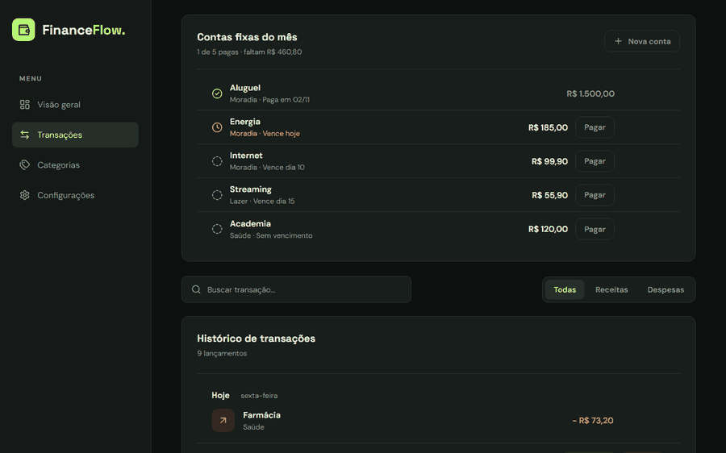
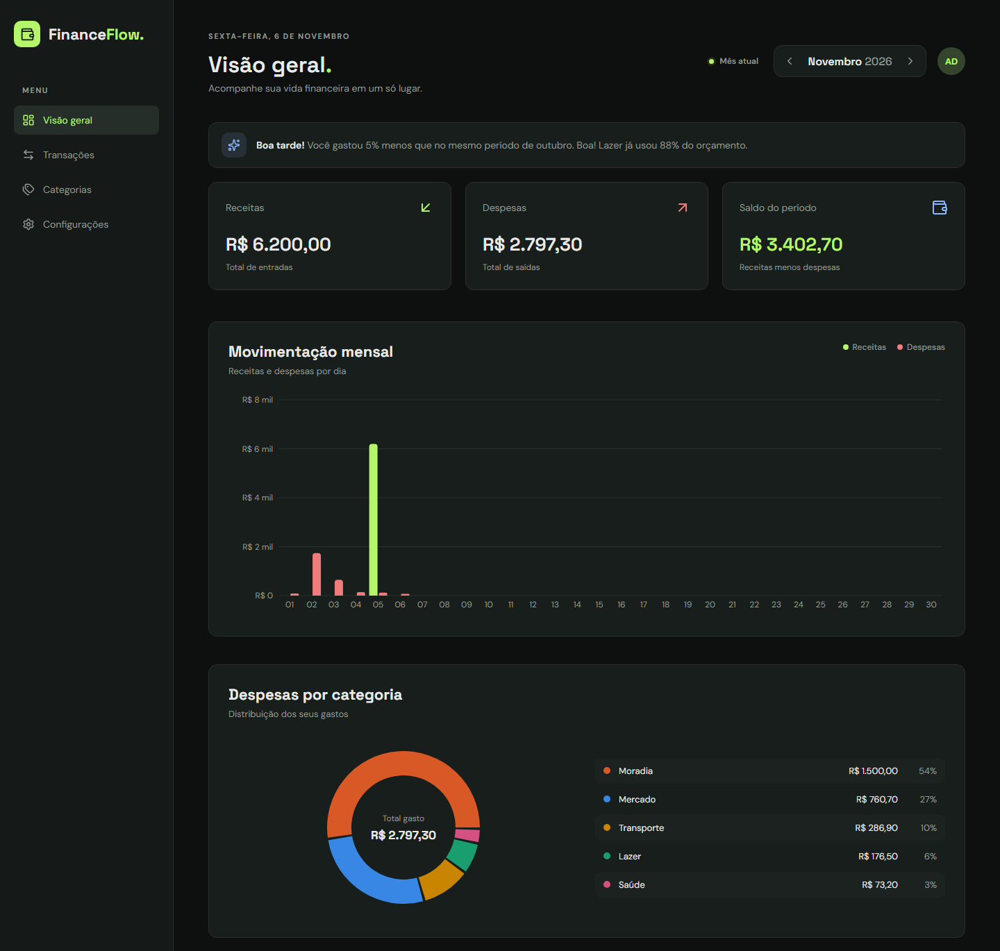
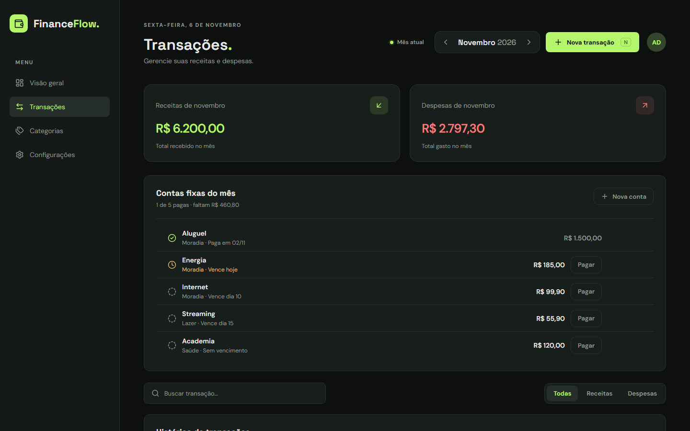
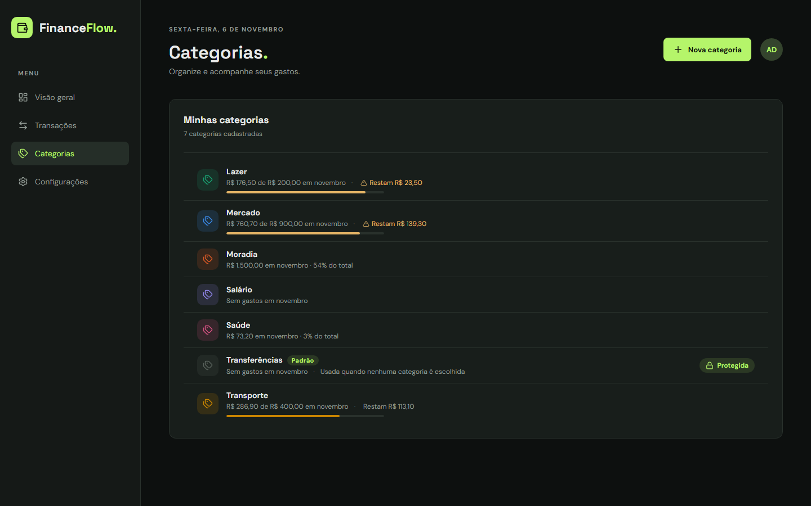
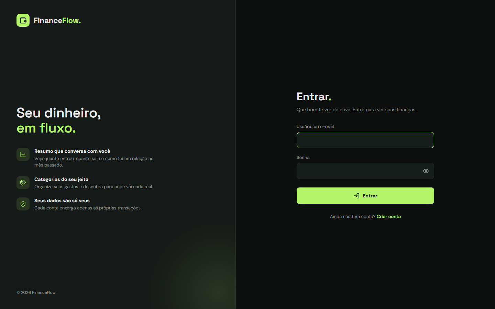
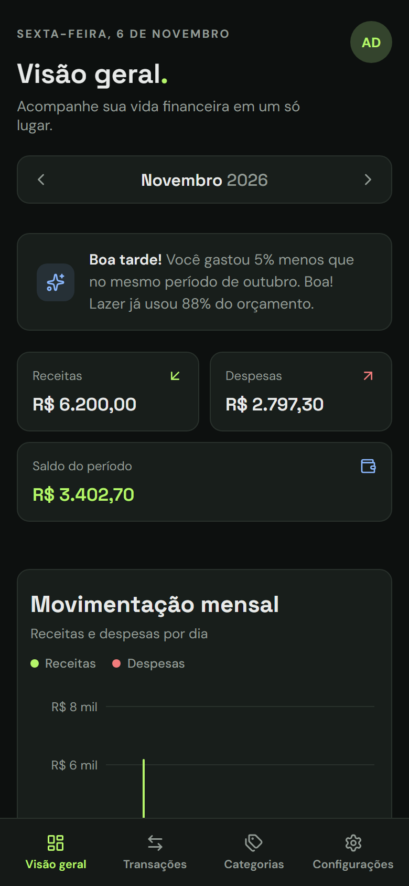
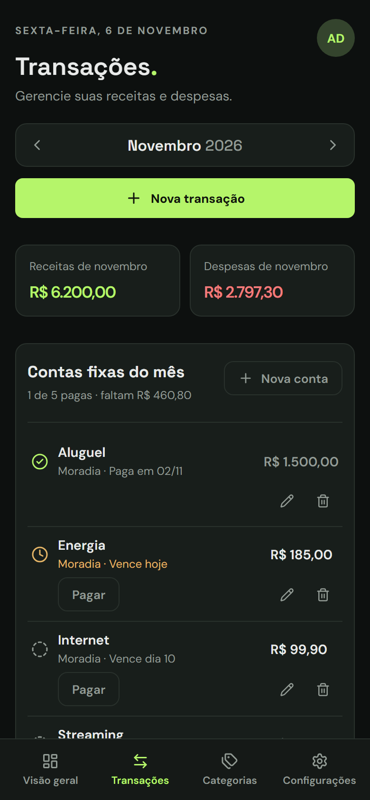
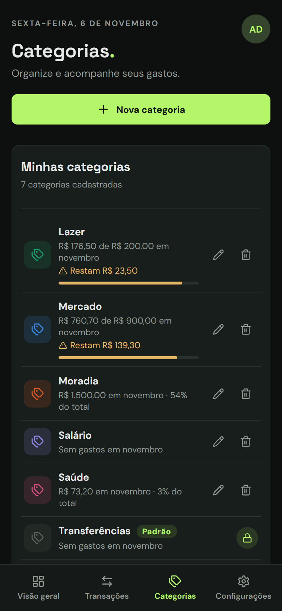

# FinanceFlow

[](https://github.com/LuisFilipe192/FinanceFlow/actions/workflows/ci.yml)

Controle financeiro pessoal multiusuário, feito com Django REST Framework e React. Registra receitas e despesas, acompanha orçamentos por categoria e organiza as contas fixas do mês.



## Funcionalidades

- **Visão geral do mês:** cartões de resumo, gráfico diário, despesas por categoria e um resumo em texto que compara o mês atual com o mesmo período do mês anterior.
- **Transações por mês:** busca, filtro por tipo e exclusão com "Desfazer" por 5 segundos.
- **Orçamento por categoria:** limite mensal opcional, com avisos a partir de 80% e ao passar de 100%.
- **Contas fixas:** aluguel, internet e outros pagamentos mensais, com vencimento opcional. Nada é lançado sozinho: você confirma cada pagamento e pode ajustar o valor.
- **Conta do usuário:** login por nome de usuário ou e-mail, edição de perfil, troca de senha e exclusão da conta com todos os dados.
- **Celular:** navegação inferior e layout próprio para telas pequenas.

## Telas

| Visão geral | Transações e contas fixas |
| --- | --- |
|  |  |

| Categorias e orçamentos | Login |
| --- | --- |
|  |  |

<p align="center">
  
  
  
</p>

As telas usam dados fictícios.

## Tecnologias

| Camada | Ferramentas |
| --- | --- |
| Backend | Python 3.14, Django 6.1, Django REST Framework, django-ratelimit, SQLite |
| Frontend | React 19, Vite 8, React Router, Recharts, CSS puro com tokens de design |
| Testes | Django TestCase, Vitest, Playwright |
| CI | GitHub Actions |

## Como rodar

Você precisa de Python 3.14 e Node.js 24 (as versões usadas no CI).

**Backend**, em http://localhost:8000:

```bash
python -m venv .venv
.venv\Scripts\activate          # Linux ou macOS: source .venv/bin/activate
pip install -r requirements.txt
python -c "import secrets; t = open('.env.example').read(); open('.env', 'w').write(t.replace('DJANGO_SECRET_KEY=', 'DJANGO_SECRET_KEY=' + secrets.token_urlsafe(64), 1))"
')"
python manage.py migrate
python manage.py runserver 8000
```

**Frontend**, em http://localhost:5173, em outro terminal:

```bash
cd frontend
npm install
npm run dev
```

O comando `python -c` cria o arquivo `.env` a partir do `.env.example`, com uma chave aleatória só sua. Ele fica fora do git, e o Django não inicia sem ele.

Abra o app por `localhost`, não por `127.0.0.1`: os cookies de sessão dependem disso. Depois é só criar uma conta na tela de cadastro.

## Testes

```bash
python manage.py test transactions   # backend

cd frontend
npm run lint
npm test                             # testes unitários (Vitest)
npm run build
npm run check:bundle                 # sem source maps nem segredos
npx playwright install chromium      # só na primeira vez
npm run test:e2e                     # ponta a ponta (Playwright)
```

São cerca de 160 testes, e o CI roda todos a cada push na `main`. O E2E liga o backend e o frontend sozinho. Fora do Windows, aponte para o Python do ambiente com `E2E_PYTHON=python`.

## Decisões técnicas

- **Sessão do Django em vez de JWT.** O cookie `HttpOnly` não fica acessível ao JavaScript, e nada sensível é guardado em `localStorage`. As requisições que alteram dados usam proteção CSRF.
- **A segurança fica no backend.** Toda consulta filtra pelo usuário logado, e o registro de outra pessoa responde 404, sem confirmar que ele existe.
- **Nada sensível no navegador.** O cookie de sessão é `HttpOnly`, e `localStorage`, `sessionStorage` e IndexedDB ficam vazios, o que um teste E2E comprova. O build de produção sai sem source maps, e o CI reprova o bundle se aparecer um segredo ou uma variável `VITE_` com nome de chave.
- **Rate limit por falhas.** O login conta só as tentativas erradas, por usuário e por IP, e o limite é conferido antes de testar a senha. Assim, quem está bloqueado não descobre se acertou.
- **E-mail único sem modelo de usuário customizado.** Um índice único em `LOWER(email)`, criado por migration, garante a regra no banco mesmo com cadastros simultâneos.
- **Pagamento de conta fixa é uma transação comum.** "Paga no mês" significa que existe uma transação vinculada naquele mês. Não há estado duplicado, e o pagamento entra sozinho no Dashboard e no orçamento.
- **Comparação justa entre meses.** No mês em andamento, o resumo compara com os mesmos dias do mês anterior, e não com o mês inteiro.
- **Cores que seguem a categoria.** A cor vem da categoria, não da posição no ranking, então não muda de um mês para o outro. A paleta foi validada para daltonismo, e verde e vermelho ficam reservados para receita e despesa.

## Estrutura

```text
config/                 configurações do Django
transactions/
  api/                  views e serializers da API REST
  services/             regras do dashboard e das contas fixas
  auth_backends.py      login por usuário ou e-mail
  tests.py              testes do backend
frontend/
  src/pages/            telas
  src/components/       componentes reutilizáveis
  src/services/         chamadas à API
  src/utils/            regras puras, com testes unitários
  e2e/                  testes Playwright
```

## Próximos passos

- Publicar online, com PostgreSQL, variáveis de ambiente, HTTPS e Redis para o rate limit. O projeto ainda está em configuração de desenvolvimento.
- Recuperação de senha por e-mail.
- Exportação dos dados em CSV.
- Recomendações com IA.
